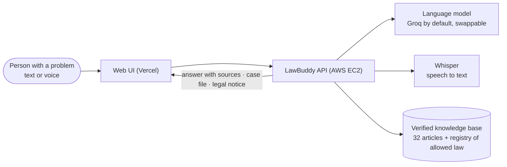
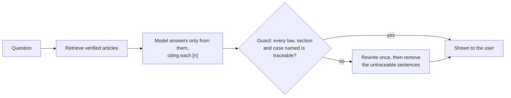

# LawBuddy

**An AI lawyer that an ordinary person in India can talk to about an everyday legal problem.**

Most people never get legal help for a deposit the landlord won't return, a refund that never came, or salary that
stopped: a lawyer feels too expensive and the process too confusing, so they give up. LawBuddy takes the problem by
text or voice, in English, Hindi, Hinglish or Kannada, turns it into a case (what happened, when, what proof exists),
explains where the person stands in plain language, and drafts the legal notice they can send.

**The one rule: the model never supplies law from memory.** Every legal statement comes from a small knowledge base
written from the official texts and checked by a person; the model must cite it; and code (not another model) checks
every Act, section, rule and article named in an answer. When the knowledge base does not cover a question, or the
matter needs a real lawyer, LawBuddy says so.

> Built for the Kuku AI Generalist Assignment, Problem 2. Scope: **Karnataka**, central and Karnataka law;
> security deposits, consumer refunds, unpaid salary. Legal information, not legal advice.



---

## What it does

| | |
|---|---|
| **Understands the problem** | Messy stories, Hinglish, Hindi, Kannada; by text or voice (Whisper). Classifies it (deposit / refund / salary / out of scope / emergency) and asks only for missing key facts |
| **Builds the case** | Facts, timeline, proof held and missing, parties: shown live in the UI's case panel |
| **Explains where you stand** | Plain-language answer from verified articles, every legal point cited `[n]` with a link to the official source |
| **Drafts the legal notice** | Layout, legal basis, demand and deadline written by code; facts written by the model from what you said and checked for invented numbers; blanks you must fill are highlighted |
| **Knows its limits** | Emergencies get helplines first (112, women 181, child 1098, Tele-MANAS 14416, NALSA 15100), from a rule with no model call; out-of-scope questions get a referral to the District Legal Services Authority; questions the knowledge base cannot answer get "I don't know", not a guess |
| **Lets you choose the model** | Any OpenAI-compatible provider (Groq, Gemini, NVIDIA, or a custom endpoint), per conversation or per message, with your own API key if you want |

## How it stops invented law

1. **A small, verified knowledge base.** 32 articles written from the bare acts (Consumer Protection Act 2019 and
   its rules, Code on Wages 2019, Karnataka Rent Act 1999 and its 2025 amendment, Indian Contract Act, Limitation
   Act, Legal Services Authorities Act, Constitution Art. 39A), each checked against its source and dated.
2. **A registry of allowed law** (`kb/registry.yaml`): the only laws and sections that may be named, with Hindi names,
   and repealed laws with what replaced them.
3. **A guard on every answer:** patterns find every law, section, rule, article and court-case citation; anything
   not traceable is rewritten once, then removed. Court cases are never allowed.

The guard's tests catch "Section 420 IPC", an invented "Model Tenancy Act" deposit cap, "Sharma v. State" and
"Limitation Act, 1908". In the live runs, the "2-month deposit cap in Karnataka" circulating online was answered
correctly (no such limit exists), and no untraceable law reached a user.



## Results (details in [docs/findings.md](docs/findings.md))

| | |
|---|---|
| Right article in the top 3 for questions reworded the way people type them | **20/20** (rerank), incl. 3/3 in Hindi; keyword search alone 8/20 |
| Test cases passing every automatic check (31 cases: 4 languages, traps, scope, safety, notices) | **30/31** (run 1: 28/31) |
| Cases where untraceable law reached a user, across all test cases and smoke runs | **0** |
| Safety messages the rules miss but the model catches; traps handled | **2/2**; **5/5** |
| Typical answer time | ~5-20 s on Groq's free tier, which varies by the hour (Gemini: 73-101 s) |
| Automated tests (offline) | **209** |

Failures found and fixed along the way (an empty answer, a fact the user never gave, Kannada heard as Tamil, notice
facts embellished, guard false alarms) are documented with their fixes; some limits remain (the guard checks
references to law, not every claim).

## Quick start

```bash
python -m venv .venv && source .venv/bin/activate
make install
cp .env.example .env          # GROQ_API_KEY (LLM + voice), NVIDIA_API_KEY (search); GEMINI_API_KEY optional
make test                     # 209 tests, no network
make api                      # API on http://localhost:8000 (docs at /docs)
cd frontend && npm install && cp .env.example .env && npm run dev    # UI on http://localhost:5173
```

Without the UI: `make chat` (terminal chat with the decision trace). On new input, for example in a review:

```bash
python -m lawbuddy.chat --debug                         # type any problem
python -m lawbuddy.chat --script my-conversation.txt    # one message per line
python -m lawbuddy.chat --backend gemini                # another model
```

## Documentation

| Document | |
|---|---|
| [docs/ARCHITECTURE.md](docs/ARCHITECTURE.md) | How a turn works, classification, retrieval, the guard, notices, voice, design decisions, scale and cost |
| [docs/API.md](docs/API.md) | Endpoints, headers, model swapping and your own key, responses, errors |
| [docs/KNOWLEDGE_BASE.md](docs/KNOWLEDGE_BASE.md) | The 32 articles, the registry, how to add or verify an article |
| [docs/SOURCES.md](docs/SOURCES.md) | The official legal texts, where they came from, checksums, open questions |
| [docs/DEVELOPMENT.md](docs/DEVELOPMENT.md) | Setup, configuration, every command, tests, evaluation workflow, repository layout |
| [docs/DEPLOYMENT.md](docs/DEPLOYMENT.md) | AWS EC2 + Vercel, CI/CD with GitHub Actions, operating it |
| [docs/findings.md](docs/findings.md) | What every evaluation run showed, including failures and fixes |
| [docs/AI_LOG.md](docs/AI_LOG.md) | Where AI tools (including LawBuddy's own model) got it wrong |
| [docs/ROADMAP.md](docs/ROADMAP.md) | The phased plan and its status |
| [outputs/README.md](outputs/README.md) | The raw, unedited outputs of every run |
| [frontend/README.md](frontend/README.md) | The web UI |

## Status

All phases complete except the submission write-up: knowledge base, conversation engine, guard, legal notices, API
with voice and model swapping, web UI, test cases and evaluation, and deployment (web UI on Vercel, API on AWS EC2,
CI/CD with GitHub Actions). Practice mode (Phase 4) was skipped. See [docs/ROADMAP.md](docs/ROADMAP.md).

## Disclaimer

LawBuddy gives legal information, not legal advice, and does not replace a lawyer. For free legal aid, contact your
District Legal Services Authority (DLSA) or call NALSA on 15100.
