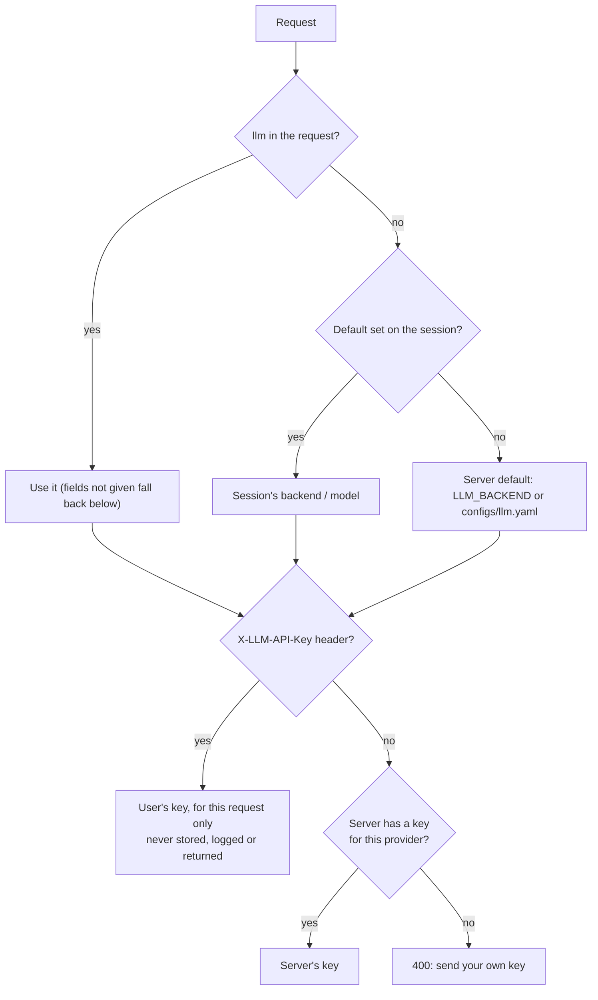
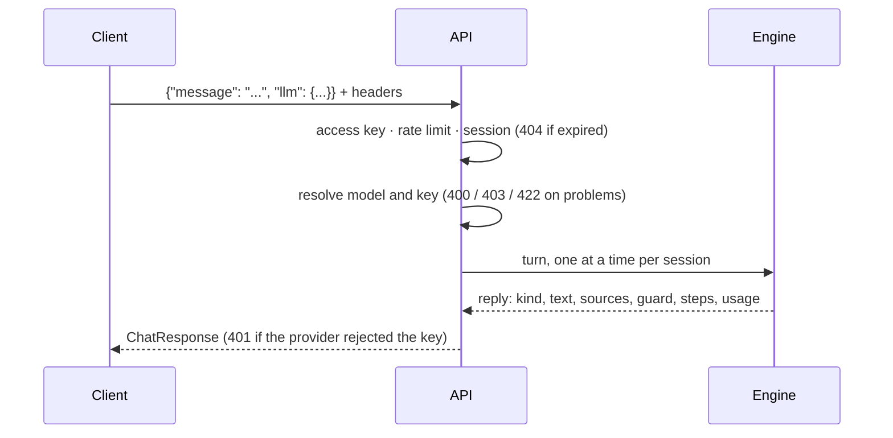
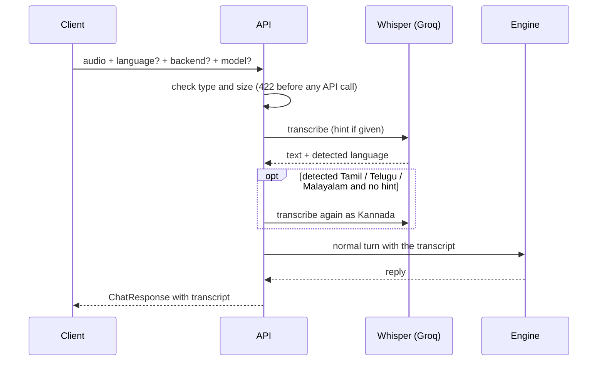

# API reference

FastAPI service in `src/lawbuddy/api/` (`main.py`, `schemas.py`). Start it with `make api`; interactive docs at
`http://localhost:8000/docs` (OpenAPI at `/openapi.json`).

## Headers

| Header | When | Meaning |
|---|---|---|
| `X-API-Key` | if the server sets `LAWBUDDY_API_KEY` | Access to `/sessions/*` and `/transcribe`. `/health` and `/backends` are open |
| `X-LLM-API-Key` | optional | Your own key for the chosen LLM provider; replaces the server's key **for this request only**. Never stored, logged or returned |

Search (embeddings and rerank) always uses the server's NVIDIA key. For voice, `X-LLM-API-Key` is also used for
Whisper only when the chosen LLM backend is the transcription backend (Groq): a Gemini key is never sent to Groq.

## Choosing the model



Any request that runs a model accepts `llm` (form fields `backend` and `model` for voice):

```json
{"llm": {"backend": "gemini", "model": "gemini-3.8-flash"}}
```

- `backend`: one of `GET /backends`, or `custom`. Omitted fields use the session's choice, then the server default
  (`LLM_BACKEND` or `configs/llm.yaml`).
- `model`: another model of the same provider (letters, digits and `. - / : @ _`, up to 120 characters). A backend's
  `extra_body` (for example `reasoning_effort`) applies only to its configured model.
- `custom`: any OpenAI-compatible endpoint, with `base_url` (https only), `model` and an `X-LLM-API-Key`. Refused
  (403) unless the server sets `ALLOW_CUSTOM_LLM_BASE_URL=1`.

## Endpoints

### `GET /health`

```json
{"status": "ok", "backend": "groq", "llm": "openai/gpt-oss-120b", "kb_chunks": 32, "kb_verified": 32,
 "retrieval": "rerank", "sessions": 0}
```
`retrieval` is `rerank`, `dense`, or `keyword search only: …` when the server has no NVIDIA key.

### `GET /backends`

```json
{"backends": [{"name": "groq", "model": "openai/gpt-oss-120b", "base_url": "https://api.groq.com/openai/v1",
               "server_key": true, "default": true}, "..."],
 "custom_allowed": false, "transcription_model": "whisper-large-v3-turbo", "transcription_server_key": true}
```
`server_key: false` means the user must send `X-LLM-API-Key` to use that backend.

### `POST /sessions` → 201

Body (optional): `{"llm": {"backend": "gemini"}}`, the conversation's default model. Returns a `SessionInfo`:
`session_id`, `created_at`, `language`, `llm`, `messages`, `case`, `drafts`.

### `GET /sessions/{id}` · `DELETE /sessions/{id}` → 204

The conversation so far, or forget it. Unknown or expired id → 404. Sessions expire after `SESSION_TTL_MIN` idle
minutes (default 120); at most `MAX_SESSIONS` (default 500) are kept, oldest idle first out.

### `POST /sessions/{id}/messages`



```json
{"message": "My landlord in Bengaluru is not returning my deposit of 1.5 lakh", "llm": {"backend": "groq"}}
```
`message`: 1-4000 characters. Returns a `ChatResponse`:

| Field | Meaning |
|---|---|
| `kind` | `emergency`, `escalate` (out of scope), `clarify`, `follow_up`, `not_found`, `advice`, `draft`, `error` |
| `text` | Markdown in the user's language; `[n]` refers to `sources[n-1]` |
| `language`, `category` | as understood this turn |
| `sources` | `n`, `cited`, `chunk_id`, `title`, `category`, `kind` (guide / statute / practice), `score`, `urls` (official sources), `verified_on` |
| `case` | the case file: `category`, `facts`, `missing` (critical first), `timeline`, `evidence_have`, `evidence_missing`, `other_party`, `user_goal`, `state`, `summary`, `parties` |
| `guard` | `checked`, `regenerated`, `removed`, `first_problems`, `problems`, `uncited_sentences` |
| `retrieval` | `query`, `mode` (`primary` or `fallback`), `top_score`, `floor`, `seconds` |
| `draft` | for `kind: draft`: `n`, `category`, `text`, `placeholders`, `warnings`, `chunks` |
| `transcript` | for voice: what was heard |
| `model` | `"backend / model"` that answered |
| `steps` | the turn's decision trace |
| `error` | for `kind: error`: what failed, with keys redacted |
| `usage` | `llm_calls`, `input_tokens`, `output_tokens`, `llm_s`, `retrieval_s` |
| `latency_ms` | total time of the turn |

### `POST /sessions/{id}/voice` (multipart)



Fields: `audio` (file: flac, m4a, mp3, mp4, mpeg, mpga, oga, ogg, wav, webm; up to 20 MB), optional `language`
(`en`, `hi`, `kn`, …), optional `backend` and `model`. Transcribes, then runs a normal turn; returns a
`ChatResponse` with `transcript`. The first step of `steps` records what Whisper heard, including
"Whisper detected Tamil; transcribed again as Kannada" when that happens. No speech → 422.

### `POST /transcribe` (multipart)

Fields: `audio`, optional `language`. Returns `{"text", "language", "duration_s", "model", "latency_ms", "note"}`.

### `POST /sessions/{id}/draft`

Drafts the legal notice now from the case so far (the UI's "Draft notice" button). Body optional: `{"llm": {...}}`.
No deposit / consumer / salary case yet → 409. Returns a `ChatResponse` with `kind: draft` and `draft`.

### `GET /sessions/{id}/drafts/{n}`

The n-th notice of the conversation as `text/markdown`, with
`Content-Disposition: attachment; filename="legal-notice-<category>-<n>.md"`. Unknown n → 404.

## Errors

| Status | When |
|---|---|
| 400 | No API key for the chosen backend (neither on the server nor in `X-LLM-API-Key`) |
| 401 | Wrong or missing `X-API-Key`; or the LLM / Whisper provider rejected the key |
| 403 | Backend `custom` while it is disabled |
| 404 | Unknown or expired session; unknown draft |
| 409 | Draft requested before there is a case |
| 422 | Invalid body (empty or too long message, bad model name, `custom` without https), bad audio type or size, no speech |
| 429 | More than `RATE_LIMIT_PER_MIN` requests per minute from one IP (default 20) |
| 502 | Transcription failed upstream |

Other model failures during a turn do not fail the request: they return `kind: error` with a redacted `error`, and
the conversation can continue.

## Example (curl)

```bash
SID=$(curl -s -X POST localhost:8000/sessions | python -c "import sys,json;print(json.load(sys.stdin)['session_id'])")
curl -s -X POST localhost:8000/sessions/$SID/messages -H 'content-type: application/json' \
     -d '{"message": "Is there a 2 month limit on security deposits in Karnataka?"}'
curl -s -X POST localhost:8000/sessions/$SID/voice -F audio=@eval/audio/salary-kn.wav -F language=kn
curl -s -X POST localhost:8000/sessions/$SID/messages -H 'content-type: application/json' \
     -H "X-LLM-API-Key: $MY_GEMINI_KEY" -d '{"message": "draft the notice", "llm": {"backend": "gemini"}}'
```

`make api-smoke` runs every endpoint against a running server and saves the raw responses to `outputs/api_smoke/`.
