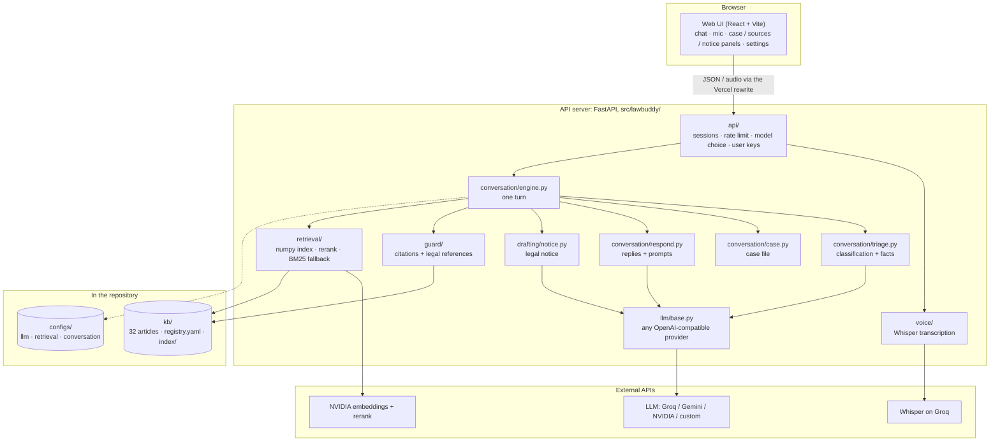
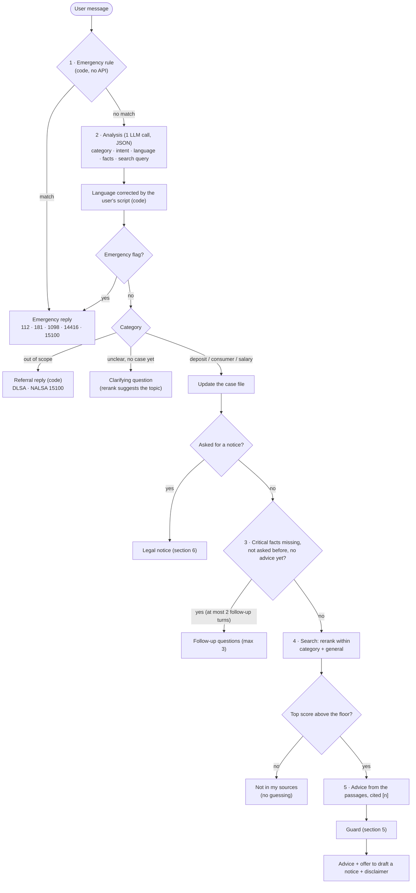
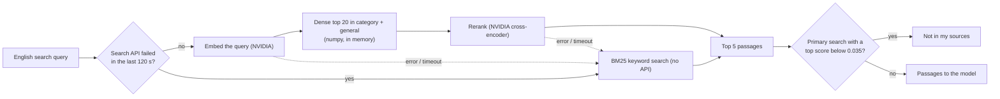
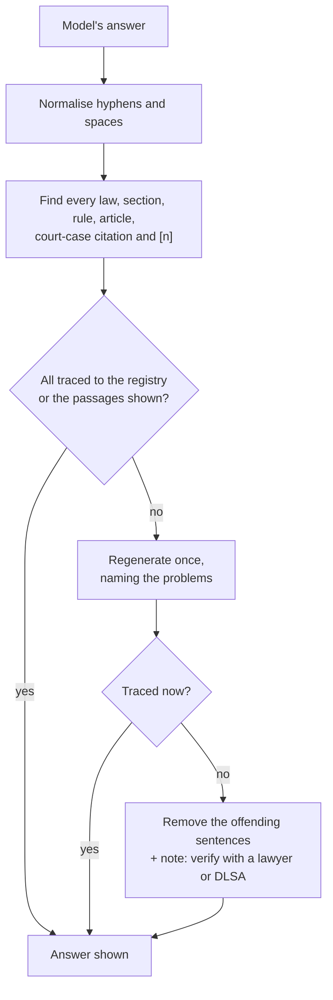
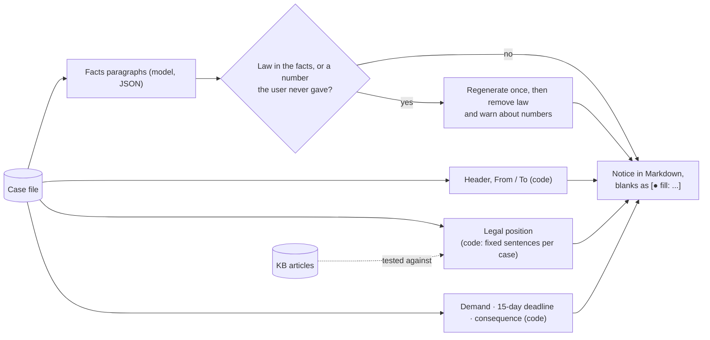
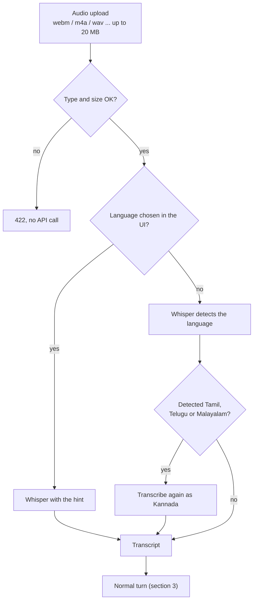
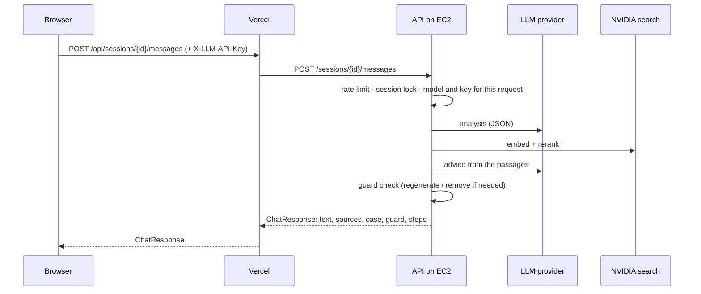
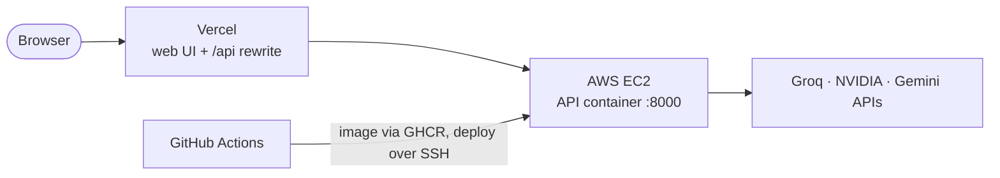

# Architecture

How LawBuddy works, why it is built this way, and what it costs. For the endpoints see [API.md](API.md); for the
legal content see [KNOWLEDGE_BASE.md](KNOWLEDGE_BASE.md); for measured results see [findings.md](findings.md).

## 1. The problem and the one rule

LawBuddy is a conversational assistant for ordinary people in Karnataka with three everyday legal problems: a
security deposit not returned, a refund or faulty product or service, and unpaid salary. It takes the problem by
text or voice (English, Hindi, Hinglish, Kannada), builds the case, explains where the person stands, and drafts a
legal notice.

The risk that shapes everything: language models confidently invent laws, section numbers and court cases. So:

> **The model never supplies law from memory.** Every legal statement comes from a small, hand-verified knowledge
> base, the model must cite it, and code (not another model) checks every law, section, rule and article named.

What the model does, and what code does:

| The model | Code |
|---|---|
| Understands messy stories, Hinglish, Hindi, Kannada | Emergency detection (rules) and every fixed reply (emergency, referral, "not in my sources") |
| Classifies the problem and extracts the facts | Decides which facts are missing and whether to ask |
| Rewrites the message as an English search query | Retrieval, the score floor, the keyword fallback |
| Writes the answer from the passages it is given | Checks every legal reference; regenerates, then removes what cannot be traced |
| Writes the facts paragraphs of a notice | Writes the notice's layout, legal basis, demand and consequence; checks the facts for law and invented numbers |

## 2. Components

| Module | Responsibility | Key file(s) |
|---|---|---|
| `llm` | `get_llm(backend, model, api_key, base_url)`; `chat()`, `chat_json()` with one retry (bigger budget if a reasoning model was cut off) | `llm/base.py` |
| `kb` | Load and validate the KB against the registry; embed changed chunks; extract source PDFs; set `verified_on` | `kb/loader.py`, `kb/build.py`, `kb/extract.py`, `kb/verify.py` |
| `retrieval` | Dense search over an in-memory numpy index with category filters; cross-encoder rerank; BM25 fallback with a 120 s cooldown after an API failure | `retrieval/index.py`, `reranker.py`, `lexical.py`, `factory.py` |
| `guard` | `[n]` citation checks; the legal-reference guard; removal of untraceable sentences | `guard/citations.py`, `guard/legal_refs.py` |
| `conversation` | One turn of the conversation, from emergency rule to checked advice | `conversation/engine.py` |
| `drafting` | Legal notice: code-written legal parts, model-written facts, checked | `drafting/notice.py` |
| `voice` | Whisper transcription, file checks, Kannada retry | `voice/transcribe.py` |
| `api` | HTTP service, sessions, keys, voice, downloads | `api/main.py`, `api/schemas.py` |
| `chat.py` | Terminal chat (interactive or scripted) | `chat.py` |
| `evaluation` | Retrieval smoke test, API smoke test | `evaluation/retrieval_smoke.py`, `evaluation/api_smoke.py` |

## 3. One turn, step by step (`conversation/engine.py`)

Every turn records a `trace` (what was decided and why), token usage, and LLM time versus search time. The trace is
shown in the UI under "Why this answer?" and in `make chat --debug`.

### Classification: three layers

| Layer | Decides | Why this layer |
|---|---|---|
| 1. Rules (`triage.emergency_rule`) | Danger to life or safety, in English, Hinglish and Hindi | Must work with every API down; recall over precision |
| 2. LLM analysis (`triage.analyze`) | deposit / consumer / salary / out_of_scope / unclear, plus intent, language and facts | Only a model can read "owner still sitting on the 2L I gave" or tell an eviction threat from a deposit dispute |
| 3. Rerank evidence check (`engine._search`) | Whether the KB has anything to answer with; for unclear messages, the likely topic to confirm | A similarity score alone cannot decide scope: near-topic questions (eviction, PF, a bounced cheque) scored like real ones (findings, Phase 1) |

Out-of-scope messages get a fixed referral reply written in code (DLSA, NALSA 15100), never model-written legal
content.

### The case file (`conversation/case.py`)

Facts per problem type (for a deposit: amount, move-out date, written agreement, city, landlord's reason, how it was
paid), a timeline, proof held and proof the user says they lack, parties (names, addresses), the user's goal and
state. Code lists the *critical* facts per type (deposit: amount and move-out date) and asks for them, at most two
follow-up turns of three questions. General questions skip the follow-ups. A fact is never asked twice, and once
advice has been given there are no more follow-ups (a user who answered "kal raat" was asked the same question again
before this rule; findings, Phase 6).

The advice prompt shows the case as "what the user told us" and "not discussed yet", never as `null`: shown nulls, a
model told a user they had no rental agreement (findings, Phase 2).

### Language

The analysis labels the user's language; replies are written in it. The script is then corrected in code
(`conversation/language.py`): a Latin-script message labelled "Hindi" is answered in Hinglish, a Devanagari one in
Hindi, a Kannada-script one in Kannada. Retrieval runs on the English search query, which must keep every fact that
could change the answer (bought for a shop, online or offline, employed or left); dense search also handled Hindi
directly (3/3).

## 4. Retrieval

- **Knowledge base:** 32 short articles (18 plain-language guides, 9 verbatim statute extracts, 5 practice notes),
  one file each, in `kb/<category>/`. See [KNOWLEDGE_BASE.md](KNOWLEDGE_BASE.md).
- **Index:** `kb/index/vectors.npz` (32 × 1024 floats, NVIDIA `nemotron-3.5-embed-8b`) and `chunks.json`, ~130 KB,
  committed. A search is one matrix-vector product in memory; there is no vector database.
- **Search:** the dense top 20 within `{category, general}`, re-sorted by NVIDIA's cross-encoder reranker; top 5 to
  the model.
- **Floor:** rerank 0.035 / dense 0.28, below which nothing is shown and LawBuddy says it does not know. It rejects
  no real question in either smoke set; scope is decided by classification, not by this number.
- **Fallback:** if the embedding or rerank API fails, BM25 keyword search answers, and the API is skipped for 120 s
  so every turn does not wait on timeouts. The floor is not applied to BM25 scores.

Results: reranked search found the right article in the top 3 for 20/20 reworded questions, including Hindi;
keyword search alone, 8/20 (findings, Phase 1).

## 5. The legal-reference guard (`guard/legal_refs.py`)

Runs on every answer, with patterns, not a model:

| Problem | Example caught |
|---|---|
| `case_law` | "Sharma v. State", "AIR 2019 SC 123", "(2020) 3 SCC 45", "the Supreme Court has held" |
| `unknown_law` | "Model Tenancy Act, 2021" (not in the registry or the passages shown) |
| `wrong_year` | "Limitation Act, 1908" |
| `repealed_law` | "Section 420 IPC", "Payment of Wages Act" used as if in force |
| `unlisted_section` | "Section 21 of the Karnataka Rent Act", "धारा 50" of the Code on Wages |
| `unanchored_section` | "Section 12 says…" with no law named |
| `invalid_citation` | `[7]` when 5 passages were shown |

- Law names are matched from `kb/registry.yaml`, including Hindi names ("कोड ऑन वेजेज"). A section is tied to its
  law: "section N **of** X" binds to X; otherwise the nearest law named before it.
- A law or section that appears in the passages shown is accepted (it comes from the verified KB).
- Model text is normalised first (no-break hyphens and spaces), so "E‑Commerce" matches the registry.
- On a problem: regenerate once with the problems named; if it fails again, remove the offending sentences and add a
  note to verify with a lawyer or the DLSA. Sentences without a citation are reported as warnings, not removed.

What it does not catch: a claim that names no law but misstates a rule ("the Commission will admit within 21 days"),
or a law named without "Act", "Code" or "Rules" ("the Sale of Goods law"; findings, Phase 6).

## 6. Legal notices (`drafting/notice.py`)

| Part | Written by |
|---|---|
| Layout, date, delivery method, signature block | code |
| From / To | code, from the case (the employer or seller fills To when named); unknown → `[● fill: …]` |
| Facts | **the model**, as JSON paragraphs that code numbers |
| Legal position | code: fixed sentences chosen per case (wages s. 17(2) if the user left, s. 17(1) if employed, both if unknown, plus s. 45; e-commerce rule 6(3) only for online purchases; Contract Act ss. 73-74 for deposits) |
| Demand (15-day deadline) and consequence | code; amounts formatted as rupees ("Rs. 1,50,000"); the salary total is never computed |

Every legal sentence a notice can contain is tested against the KB chunks it names with the guard
(`tests/test_notice.py`). The facts are checked in code: no law, and every number must appear in what the user said
("2 lakh" = "Rs. 2,00,000"); one regeneration, then law is removed and unsupported numbers become warnings.
Embellishments without numbers ("in good condition") cannot be checked in code; the prompt forbids them and the user
is told to check every fact.

## 7. Voice (`voice/transcribe.py`)

Audio (webm, m4a, wav, ogg, mp3 …, up to 20 MB) → Whisper `whisper-large-v3-turbo` on Groq → the transcript goes
through the normal turn. The UI offers a language choice (Auto / EN / HI / KN) sent as a hint. Without a hint,
Whisper heard Kannada as Tamil; now, if it reports Tamil, Telugu or Malayalam, the audio is transcribed again as
Kannada (recorded in the trace).

## 8. The API and sessions

FastAPI with Pydantic models ([API.md](API.md)). Sessions live in memory with a 2-hour idle expiry and a cap of
500; one turn at a time per conversation; the shared retriever reports its mode per thread so concurrent turns
cannot mix score scales. The user's own LLM key (`X-LLM-API-Key`) replaces the server's key for that request and is
never stored, logged or returned. A `custom` backend (any https OpenAI-compatible URL) is off unless enabled, since it
makes the server call a URL the client chooses.

## 9. Design decisions

| Decision | Chosen | Not chosen, and why |
|---|---|---|
| Vector store | numpy in memory | Qdrant / a vector DB: 32 vectors (~130 KB); a server adds operations and cost for no benefit until ~10⁵ chunks |
| Orchestration | Plain functions in `engine.py` | LangGraph: five linear steps, each tested alone; a graph framework added nothing |
| Knowledge | 32 hand-written, verified articles + verbatim extracts | Indexing whole bare acts (or the 402-page Constitution): retrieval would surface unrelated sections the model could then cite "correctly" |
| Scope decision | LLM classification + rerank evidence check | A similarity threshold: measured to overlap for near-topic questions |
| Hallucination control | Pattern-based guard + registry | A second "judge" model: it can hallucinate too, and costs another call per turn |
| Fixed replies | Code templates (EN/HI) | Model-written: emergency and referral text must be right every time |
| Notice | Code template + model facts | Fully model-written: the legal basis and demand must not vary |
| Session store | In memory | Redis: one process is enough for the prototype; needed for several workers |
| Model provider | Any OpenAI-compatible endpoint, by config or per request | One fixed provider: the brief asks for easy model swapping |

## 10. Scale and cost

**Per turn (measured, Groq `gpt-oss-120b`, low reasoning effort):**

| Turn | LLM calls | Tokens in / out | Other API calls |
|---|---|---|---|
| Advice | 2 | ~3,300-4,000 / ~640-1,000 | 1 embedding + 1 rerank |
| Follow-up question | 2 | ~1,300-1,450 / ~350-450 | none |
| Referral (out of scope) | 1 | ~1,100-1,600 / ~200-650 | none |
| Emergency | 0 | 0 | none |
| Legal notice | 1-2 | ~650-2,400 / ~130-650 | none |
| Voice | + 1 Whisper call (~1 s) | | |

A typical conversation (one follow-up, two advice turns, one notice) is about 6 LLM calls and ~11k input / ~3k output
tokens, plus 2 embedding and 2 rerank calls. Cost per conversation = those tokens × the provider's per-token price;
this prototype runs on free tiers.

**At real-world volume:**
- The engine is stateless apart from sessions: run several API workers behind a load balancer with sessions in Redis.
- The KB grows by state and problem type as files: even thousands of articles fit in memory; a vector database
  becomes worthwhile around 10⁵ chunks or with frequent concurrent updates.
- Free-tier limits and latency are the real constraint (Gemini took 73-101 s per turn; NVIDIA embeddings timed out
  for minutes during development). Paid tiers, or a self-hosted model behind the same OpenAI-compatible interface,
  change one config entry.
- Cost levers: emergency and out-of-scope turns already skip retrieval and advice; the analysis call could move to a
  smaller, cheaper model; identical questions could be cached.
- Human in the loop: a person verifies every KB article against the official text (`verified_on`), and the user
  checks every drafted notice before sending. Adding a state is a content task (sources, articles, verification), not
  a code change.

## 11. Deployment

The web UI runs on Vercel, which rewrites `/api/*` to the API; the API runs as a Docker container on an AWS EC2
t3.micro. GitHub Actions tests every push and pull request, and on `main` builds the image, pushes it to GHCR and
deploys it over SSH, with a health check and automatic rollback. Details: [DEPLOYMENT.md](DEPLOYMENT.md).

