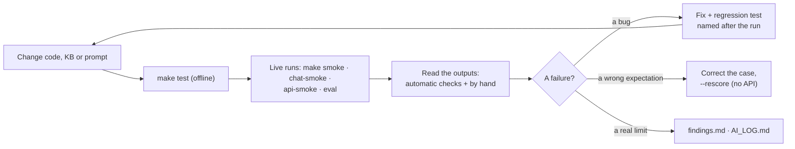

# Development

## Setup

Requirements: Python 3.11+, Node 20+ (for the web UI).

```bash
python -m venv .venv && source .venv/bin/activate
make install                          # pip install -e ".[dev]"
cp .env.example .env                  # add your keys (below)
cd frontend && npm install && cp .env.example .env && cd ..
```

## Configuration

### `.env` (server)

| Variable | Purpose |
|---|---|
| `GROQ_API_KEY` | LLM (default backend) and Whisper transcription |
| `GEMINI_API_KEY`, `NVIDIA_API_KEY` | other LLM backends; **NVIDIA is also used for embeddings and reranking** (without it, search falls back to keyword only) |
| `LLM_BACKEND` | default backend: `groq`, `gemini` or `nvidia` |
| `LAWBUDDY_API_KEY` | if set, clients must send it as `X-API-Key` |
| `CORS_ORIGINS` | browser origins allowed to call the API |
| `RATE_LIMIT_PER_MIN` | per-IP limit on protected endpoints (default 20; 0 disables) |
| `ALLOW_CUSTOM_LLM_BASE_URL` | `1` to allow backend `custom` (any https OpenAI-compatible URL) |
| `SESSION_TTL_MIN`, `MAX_SESSIONS` | idle expiry (default 120 min) and cap (default 500) of in-memory conversations |

### `frontend/.env`

`VITE_API_BASE_URL` (default `http://localhost:8000`) and `VITE_API_KEY` (only if the server requires one).

### `configs/`

| File | Holds |
|---|---|
| `llm.yaml` | backends (base URL, key variable, model, `extra_body` such as `reasoning_effort: low`), default backend, transcription (backend, model, size limit, Kannada retry list) |
| `retrieval.yaml` | embedding and rerank models and URLs, timeouts and retries, `top_k`, score floors, fallback cooldown |
| `conversation.yaml` | retriever, follow-up limits, history length, token budgets, temperature, helpline numbers |

Adding an OpenAI-compatible provider is a new entry under `backends:` in `llm.yaml`; no code change.

## Commands

| Command | Network | Does |
|---|---|---|
| `make test` | no | all unit tests (209): every turn branch, the guard, notices, KB, API, voice, with fakes |
| `make kb` | no | validate the knowledge base against the registry |
| `make kb-build` | embeddings | embed new or changed articles into `kb/index/` |
| `make smoke` | embeddings, rerank | retrieval smoke test on the original and paraphrased question sets |
| `python -m lawbuddy.evaluation.retrieval_smoke --modes keyword` | no | the same, keyword search only |
| `make chat` | all | terminal chat with the decision trace (`case` shows the case file, `quit` exits) |
| `make chat-smoke` | all | replay `eval/chat_smoke/*.txt`; transcripts to `outputs/chat_smoke/` |
| `make eval` | all | the 31 test cases on the default backend; raw results and `summary.md` in `outputs/eval/<backend>/` |
| `make eval-gemini`, `make eval-compare` | all / no | the same on Gemini; a side-by-side comparison of the saved runs |
| `python -m lawbuddy.evaluation.run_cases --group trap` / `--cases id` / `--rescore groq` | all / all / no | a subset; re-score a saved run with the current `cases.yaml` |
| `make api` | at request time | the API on :8000 (`/docs`) |
| `make api-smoke` | all | every endpoint against a running API; responses to `outputs/api_smoke/` |
| `make frontend` | no | the web UI on :5173 |
| `make docker-build`, `make docker-run` | | the API as a container (copies `src/`, `configs/`, `kb/`); production: [DEPLOYMENT.md](DEPLOYMENT.md) |
| `python -m lawbuddy.llm.base <backend>` | LLM | list a provider's models |
| `python -m lawbuddy.voice.transcribe file.wav [--language kn]` | Whisper | transcribe one file |
| `python -m lawbuddy.kb.extract` / `.verify` / `.loader` | no | PDF text extraction / mark verified / validate |

## Tests

`tests/` (pytest, no network). Fakes replace the model (`ScriptedLLM`: scripted replies, including empty or cut-off
ones), the retriever and Whisper. Many tests are named after the real failure they reproduce (for example
`test_kannada_heard_as_tamil_is_transcribed_again_as_kannada`).

| File | Covers |
|---|---|
| `test_engine.py` | every turn branch: emergency, referral, clarify, follow-ups, retrieval floor, guard regeneration and removal, API failures, language and script, timing |
| `test_legal_refs.py` | the guard: what must pass, what must be caught, anchoring, Hindi names, sentence removal, the KB against itself |
| `test_notice.py` | every legal sentence of a notice against its KB chunks; number checks; amounts; placeholders |
| `test_api.py` | all endpoints, model swapping, user keys never returned, 401/403/409/422, voice, sessions, rate limit |
| `test_cases.py` | the test-case file (well formed, every group and language, safety cases not caught by rules) and every automatic check |
| `test_kb.py`, `test_lexical.py`, `test_retrieval_smoke.py` | KB validation, index build and freshness, search, fallback and cooldown, smoke sets and paraphrase overlap |
| `test_llm.py`, `test_case.py`, `test_citations.py`, `test_reranker.py`, `test_transcribe.py` | the rest |

## Evaluation workflow



1. Unit tests on every change (`make test`).
2. Retrieval: `make smoke` after any KB change.
3. Conversations: `make chat-smoke`, then read the transcripts; each failure gets a fix and a regression test, and is
   written up in [findings.md](findings.md). AI-tool mistakes go in [AI_LOG.md](AI_LOG.md).
4. API: `make api` + `make api-smoke`.
5. Test cases: `make eval` (and `make eval-gemini`, `make eval-compare`); read `outputs/eval/<run>/summary.md`.

Raw outputs are kept unedited in `outputs/` (see `outputs/README.md`); earlier runs are archived in `runN/` folders.
Every chat turn is also appended to `data/logs/chat.jsonl` (gitignored); it records the backend name, never a key.

## Repository layout

```
configs/              llm.yaml, retrieval.yaml, conversation.yaml
src/lawbuddy/
  llm/                one interface for every OpenAI-compatible provider
  kb/                 loader + validator, build (embeddings), extract (PDF text), verify
  retrieval/          embedder, in-memory index, reranker, BM25 fallback, factory
  guard/              citation checks, legal-reference guard
  conversation/       engine (one turn), triage (classification), case file, replies
  drafting/           legal notice
  voice/              Whisper transcription
  api/                FastAPI app and Pydantic schemas
  evaluation/         retrieval smoke, API smoke
  chat.py             terminal chat
kb/                   the 32 articles, registry.yaml, index/
eval/                 retrieval smoke sets, chat smoke scripts, test recordings (audio/), cases/ (Phase 6)
outputs/              raw outputs of every evaluation run
frontend/             React + Vite + Tailwind web UI
tests/                unit tests (no network)
docs/                 architecture, API, knowledge base, development, deployment, sources, findings, AI log, roadmap
deploy/               EC2 stack: docker-compose.yml, deploy.sh, setup-ec2.sh
.github/workflows/    CI/CD
data/                 source PDFs, extracted text, logs, drafts (gitignored)
```
