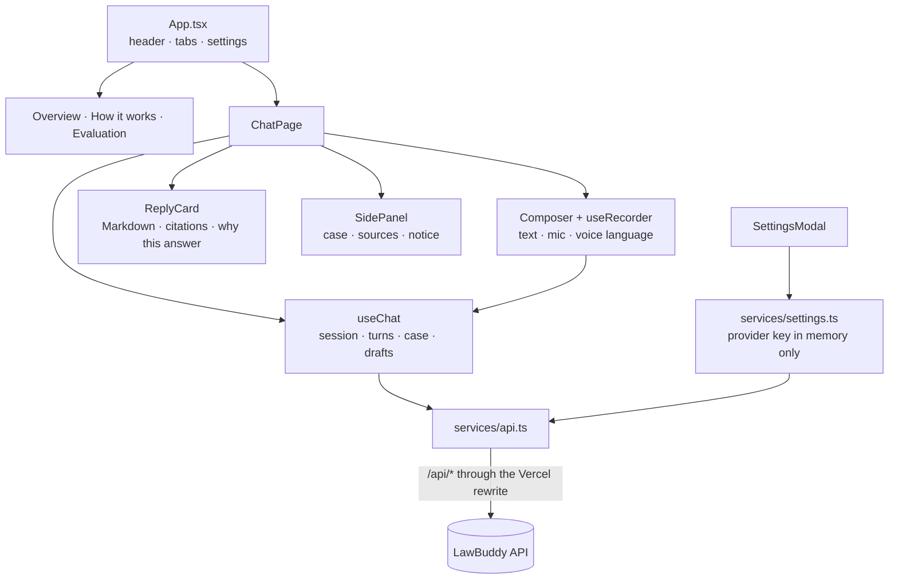

# LawBuddy web UI

React 19 + Vite + Tailwind 4 client for the LawBuddy API ([docs/API.md](../docs/API.md)).

## Running

```bash
npm install
cp .env.example .env     # VITE_API_BASE_URL=http://localhost:8000 ; VITE_API_KEY only if the server needs one
npm run dev              # http://localhost:5173 (the API must be running: make api)
npm run build            # production build in dist/
npm run lint
```

## Pages

| Page | |
|---|---|
| Overview | what LawBuddy helps with, how, and what it will not do |
| Talk to LawBuddy | the chat (below) |
| How it works | the five steps of a turn; how invented law is stopped; notices; data and keys |
| Evaluation | measured results and failures, from `docs/findings.md` |

## The chat

- **Composer:** text (Enter to send, Shift+Enter for a new line); **mic** (MediaRecorder: webm in Chrome/Firefox, mp4
  in Safari; stops at 2 minutes); **voice language** Auto / EN / हिं / ಕನ್ನ, sent as a hint to Whisper; **Draft
  notice** once a case exists; New conversation.
- **Replies:** Markdown with clickable `[n]` citations (open the source); a frame by kind (emergency, out of scope,
  not in my sources, error, notice); "Legal references checked" badge, time and model; **Why this answer?** shows
  the decision steps, search, guard result and token/time split.
- **Side panel:** *Your case* (facts given, still useful to know, timeline, proof) · *Sources* (cited articles with
  official links; the clicked one highlighted) · *Notice* (the latest draft with `[● fill: …]` highlighted, Download
  and Copy).
- **Settings:** model picker from `GET /backends` (marks providers that need your key), optional model name, **your
  own API key** (sent as `X-LLM-API-Key`; kept in memory only, never in localStorage, forgotten on reload), the
  server access key, Test connection.

A conversation lives in page memory: switching tabs keeps it, reloading starts a new one (a legal problem may be
private and the device shared). Downloads go through `fetch` so the access-key header is sent.

## Code



```
src/
  services/api.ts        API client (headers, errors, download)
  services/settings.ts   settings store; the provider key is never persisted
  hooks/useChat.ts       one conversation: session, turns, case, drafts; recreates an expired session once
  hooks/useRecorder.ts   microphone recording
  components/chat/       ReplyCard, SidePanel, Composer, labels
  components/common/     Markdown (React elements only, no innerHTML), Icons, ui
  components/layout/     Header, SettingsModal
  pages/                 Overview, Chat, HowItWorks, Evaluation
  types/api.ts           mirrors src/lawbuddy/api/schemas.py
```
